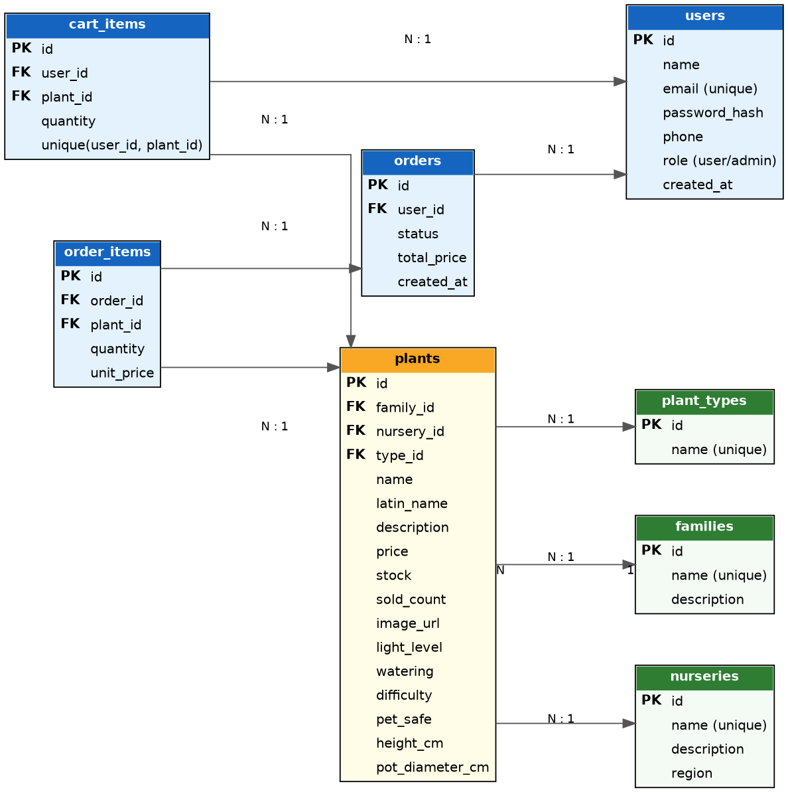

# GreenCorner

Онлайн-магазин кімнатних рослин.

## Опис

**GreenCorner** — сайт, де люди можуть підібрати та замовити кімнатні рослини для дому чи офісу.

Що є на сайті:

- **Каталог рослин.** Користувач шукає рослину за назвою (українською чи латинською), фільтрує за розсадником, типом (суккуленти, пальми, квітучі тощо), рівнем освітлення, складністю догляду та безпечністю для тварин. Результат можна сортувати від найдешевших, від найдорожчих, за популярністю та за типом.
- **Сторінка рослини.** Фото, ціна, наявність, латинська назва, опис, умови догляду (освітлення, полив), розміри, токсичність для котів і собак, посилання на родину та розсадника.
- **Ботанічні родини.** Список родин, а на сторінці родини всі рослини цієї родини, що є в наявності.
- **Розсадники.** Список розсадників (постачальників), а на сторінці розсадника всі його рослини.
- **Керування даними.** Адміністратор може додавати, редагувати та видаляти рослини, родини, розсадники й типи рослин.
- **Реєстрація та вхід.**
- **Профіль.** Авторизований користувач може змінити свої дані та переглянути історію замовлень разом зі складом кожного замовлення.
- **Кошик і замовлення.** Авторизований користувач додає рослини в кошик, а після натискання «Купити» створюється замовлення (без оплати та введення додаткових даних).
- **Сторінка «Про нас».** Контакти, умови доставки та повернення.

## Загальні домовленості API

- Базовий URL: `/api`
- Формат обміну даними: JSON (`Content-Type: application/json`)
- Авторизація: заголовок `Authorization: Bearer <token>`. Токен повертається при логіні.
- Позначки доступу: 🌐 публічний, 🔒 лише для авторизованих, 🛡️ лише для адміністратора.
- Пагінація списків: `?page=1&limit=12`. Відповідь має вигляд `{ "items": [...], "page": 1, "limit": 12, "total": 87 }`.
- Помилки повертаються у форматі `{ "error": "Опис помилки" }`.

Типові статуси помилок (не повторюються в кожному ендпоінті):

| Статус | Коли |
|---|---|
| 400 Bad Request | Некоректні дані в тілі чи параметрах запиту |
| 401 Unauthorized | Немає токена або він недійсний |
| 403 Forbidden | Недостатньо прав (потрібен адмін) |
| 404 Not Found | Ресурс не знайдено |
| 409 Conflict | Конфлікт (наприклад, email уже зайнятий) |

---

## Ендпоінти

### Автентифікація

#### `POST /api/auth/register` 🌐
Реєстрація нового користувача.

Request body:
```json
{ "name": "Олена", "email": "olena@example.com", "password": "secret123", "phone": "+380501234567" }
```
Response: `201 Created`
```json
{ "id": 1, "name": "Олена", "email": "olena@example.com", "phone": "+380501234567", "role": "user" }
```
Помилки: `400` (невалідні дані), `409` (email вже зареєстрований).

#### `POST /api/auth/login` 🌐
Вхід користувача.

Request body:
```json
{ "email": "olena@example.com", "password": "secret123" }
```
Response: `200 OK`
```json
{ "token": "eyJhbGciOi...", "user": { "id": 1, "name": "Олена", "email": "olena@example.com", "role": "user" } }
```
Помилки: `401` (невірний email чи пароль).

---

### Профіль

#### `GET /api/users/me` 🔒
Отримати дані поточного користувача.

Response: `200 OK`
```json
{ "id": 1, "name": "Олена", "email": "olena@example.com", "phone": "+380501234567", "role": "user" }
```

#### `PUT /api/users/me` 🔒
Редагувати свої дані.

Request body:
```json
{ "name": "Олена Коваль", "phone": "+380509999999" }
```
Response: `200 OK` — оновлений об'єкт користувача (як у `GET /api/users/me`).

---

### Рослини

#### `GET /api/plants` 🌐
Каталог рослин з пошуком, фільтрами, сортуванням і пагінацією.

Query-параметри (усі необов'язкові):

| Параметр | Опис |
|---|---|
| `search` | Пошук за назвою, латинською назвою або назвою родини |
| `nurseryId` | Фільтр за розсадником |
| `typeId` | Фільтр за типом рослини |
| `familyId` | Фільтр за родиною |
| `light` | `low`, `medium`, `bright` |
| `difficulty` | `easy`, `medium`, `hard` |
| `petSafe` | `true` — лише безпечні для тварин |
| `sort` | `price_asc`, `price_desc`, `popularity`, `type` |
| `page`, `limit` | Пагінація |

Приклад: `GET /api/plants?search=монстера&light=medium&petSafe=true&sort=price_asc&page=1&limit=12`

Response: `200 OK`
```json
{
  "items": [
    {
      "id": 5, "name": "Монстера", "latinName": "Monstera deliciosa",
      "price": 450, "stock": 12, "imageUrl": "https://.../monstera.jpg",
      "type": { "id": 2, "name": "Тропічні" },
      "family": { "id": 1, "name": "Ароїдні" },
      "nursery": { "id": 3, "name": "Зелений дім" }
    }
  ],
  "page": 1, "limit": 12, "total": 1
}
```

#### `GET /api/plants/{id}` 🌐
Детальна інформація про рослину.

Response: `200 OK`
```json
{
  "id": 5, "name": "Монстера", "latinName": "Monstera deliciosa",
  "description": "Декоративна ліана з великим різьбленим листям...",
  "price": 450, "stock": 12, "imageUrl": "https://.../monstera.jpg",
  "lightLevel": "medium", "watering": "Раз на 7-10 днів", "difficulty": "easy",
  "petSafe": false, "heightCm": 60, "potDiameterCm": 17,
  "type": { "id": 2, "name": "Тропічні" },
  "family": { "id": 1, "name": "Ароїдні" },
  "nursery": { "id": 3, "name": "Зелений дім" }
}
```
Помилки: `404`.

#### `POST /api/plants` 🛡️
Додати рослину.

Request body:
```json
{
  "name": "Монстера", "latinName": "Monstera deliciosa", "description": "...",
  "price": 450, "stock": 12, "imageUrl": "https://.../monstera.jpg",
  "lightLevel": "medium", "watering": "Раз на 7-10 днів", "difficulty": "easy",
  "petSafe": false, "heightCm": 60, "potDiameterCm": 17,
  "typeId": 2, "familyId": 1, "nurseryId": 3
}
```
Response: `201 Created` — створена рослина (як у `GET /api/plants/{id}`).

#### `PUT /api/plants/{id}` 🛡️
Редагувати рослину. Request body такий самий, як у `POST /api/plants`.

Response: `200 OK` — оновлена рослина. Помилки: `404`.

#### `DELETE /api/plants/{id}` 🛡️
Видалити рослину.

Response: `204 No Content`. Помилки: `404`.

---

### Родини

#### `GET /api/families` 🌐
Список усіх родин.

Response: `200 OK`
```json
[ { "id": 1, "name": "Ароїдні", "description": "Родина тропічних рослин...", "plantsCount": 8 } ]
```

#### `GET /api/families/{id}` 🌐
Інформація про родину.

Response: `200 OK`
```json
{ "id": 1, "name": "Ароїдні", "description": "Родина тропічних рослин..." }
```
Помилки: `404`.

#### `GET /api/families/{id}/plants` 🌐
Усі рослини родини (підтримує `page`, `limit`, `sort`).

Response: `200 OK` — список рослин у форматі `GET /api/plants`. Помилки: `404`.

#### `POST /api/families` 🛡️
Request body: `{ "name": "Ароїдні", "description": "..." }`

Response: `201 Created` — створена родина.

#### `PUT /api/families/{id}` 🛡️
Request body: `{ "name": "Ароїдні", "description": "..." }`

Response: `200 OK` — оновлена родина. Помилки: `404`.

#### `DELETE /api/families/{id}` 🛡️
Response: `204 No Content`. Помилки: `404`, `409` (у родини є рослини).

---

### Розсадники

#### `GET /api/nurseries` 🌐
Список усіх розсадників.

Response: `200 OK`
```json
[ { "id": 3, "name": "Зелений дім", "description": "Сімейний розсадник...", "region": "Київська область", "plantsCount": 24 } ]
```

#### `GET /api/nurseries/{id}` 🌐
Інформація про розсадник.

Response: `200 OK`
```json
{ "id": 3, "name": "Зелений дім", "description": "Сімейний розсадник...", "region": "Київська область" }
```
Помилки: `404`.

#### `GET /api/nurseries/{id}/plants` 🌐
Усі рослини розсадника (підтримує `page`, `limit`, `sort`).

Response: `200 OK` — список рослин у форматі `GET /api/plants`. Помилки: `404`.

#### `POST /api/nurseries` 🛡️
Request body: `{ "name": "Зелений дім", "description": "...", "region": "Київська область" }`

Response: `201 Created` — створений розсадник.

#### `PUT /api/nurseries/{id}` 🛡️
Request body такий самий, як у `POST /api/nurseries`.

Response: `200 OK` — оновлений розсадник. Помилки: `404`.

#### `DELETE /api/nurseries/{id}` 🛡️
Response: `204 No Content`. Помилки: `404`, `409` (у розсадника є рослини).

---

### Типи рослин

#### `GET /api/plant-types` 🌐
Список типів (для фільтра).

Response: `200 OK`
```json
[ { "id": 2, "name": "Тропічні" }, { "id": 3, "name": "Суккуленти" } ]
```

#### `POST /api/plant-types` 🛡️
Request body: `{ "name": "Суккуленти" }`

Response: `201 Created` — створений тип.

#### `PUT /api/plant-types/{id}` 🛡️
Request body: `{ "name": "Суккуленти" }`

Response: `200 OK` — оновлений тип. Помилки: `404`.

#### `DELETE /api/plant-types/{id}` 🛡️
Response: `204 No Content`. Помилки: `404`, `409` (є рослини цього типу).

---

### Кошик

#### `GET /api/cart` 🔒
Вміст кошика поточного користувача.

Response: `200 OK`
```json
{
  "items": [
    { "plantId": 5, "name": "Монстера", "imageUrl": "https://.../monstera.jpg", "unitPrice": 450, "quantity": 2, "subtotal": 900 }
  ],
  "totalPrice": 900
}
```

#### `POST /api/cart/items` 🔒
Додати рослину в кошик (якщо вже є, кількість збільшується).

Request body:
```json
{ "plantId": 5, "quantity": 1 }
```
Response: `201 Created` — оновлений кошик (як у `GET /api/cart`).
Помилки: `400` (кількість більша, ніж є на складі), `404` (рослини немає).

#### `PATCH /api/cart/items/{plantId}` 🔒
Змінити кількість рослини в кошику.

Request body:
```json
{ "quantity": 3 }
```
Response: `200 OK` — оновлений кошик. Помилки: `400`, `404`.

#### `DELETE /api/cart/items/{plantId}` 🔒
Прибрати рослину з кошика.

Response: `204 No Content`. Помилки: `404`.

#### `DELETE /api/cart` 🔒
Очистити кошик.

Response: `204 No Content`.

---

### Замовлення

#### `POST /api/orders` 🔒
Створити замовлення з поточного вмісту кошика (кнопка «Купити»). Тіло запиту не потрібне. Після створення кошик очищується, а залишок на складі зменшується.

Response: `201 Created`
```json
{
  "id": 17, "status": "created", "totalPrice": 900, "createdAt": "2026-10-13T10:15:00Z",
  "items": [ { "plantId": 5, "name": "Монстера", "quantity": 2, "unitPrice": 450 } ]
}
```
Помилки: `400` (кошик порожній або рослини немає в потрібній кількості).

#### `GET /api/orders` 🔒
Історія замовлень поточного користувача (від новіших до старіших, підтримує `page`, `limit`).

Response: `200 OK`
```json
{
  "items": [
    { "id": 17, "status": "created", "totalPrice": 900, "createdAt": "2026-10-13T10:15:00Z", "itemsCount": 2 }
  ],
  "page": 1, "limit": 10, "total": 1
}
```

#### `GET /api/orders/{id}` 🔒
Деталі замовлення зі складом. Користувач бачить лише свої замовлення.

Response: `200 OK` — об'єкт замовлення (як у відповіді `POST /api/orders`). Помилки: `404`.

---

## Схема бази даних



Короткий опис зв'язків:

- Рослина належить до однієї родини, одного розсадника й одного типу (зв'язок «багато до одного»).
- Користувач має багато позицій у кошику та багато замовлень.
- Замовлення складається з багатьох позицій (`order_items`). У позиції зберігається ціна на момент покупки (`unit_price`), щоб історія не змінювалась при зміні ціни рослини.
- `plants.sold_count` збільшується при створенні замовлення й використовується для сортування за популярністю.
